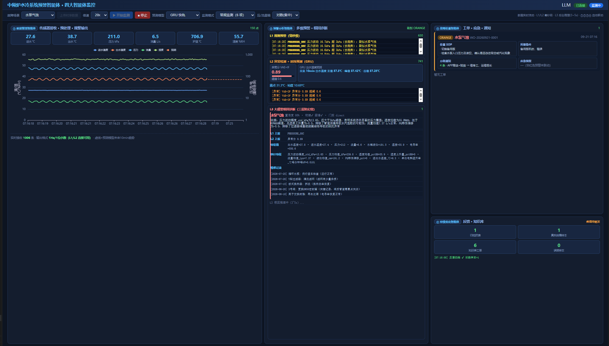

# Agent_MFF_Early_Warning

中频炉水冷系统多参数融合预警智能体。

后训练实验：[全参 / LoRA SFT 对照](design/SFT_LORA_COMPARISON.md)、[DPO / GRPO 对照及复现](design/SFT_RL_COMPARISON.md)。

难例扩展：[八类故障仿真与独立数据集](design/HARD_FAULT_DATASET.md)（1,380 条，含复合故障、缺失通道与工况偏移）。

八类后训练已完成：[Full-SFT / LoRA / DPO / GRPO 实验报告](design/HARD_POSTTRAINING_COMPARISON.md)
（2026-10-09 复核，含分层结果、炉次配对区间、错误分析、训练成本与复现命令；Full-SFT 联合准确率 90.80%）。
该实验为离线比较，八类模型尚未接入在线诊断链路。

实现从 **"事后报警"到"事前预警"**、从 **"单点监测" 到 "系统健康诊断"** 的跨越：L1 规则预警（微秒级）→ L2 趋势预测（提前 10~30min）→ L3 大模型根因诊断（三层防幻觉），并由 **四大智能体** 串联形成完整闭环。

## 一、系统架构

```
┌──────────────────── 四大智能体（server/agents.py）────────────────────┐
│                                                                        │
│  ① 数据管理智能体        ② 预警分析智能体         ③ 故障处置智能体      │
│  ────────────────  ──►  ──────────────────  ──►  ──────────────────  │
│  ·传感器采集/接收         ·L1 规则预警(14µs)         ·工单生成(10字段)   │
│   (预留Modbus/OPC UA/    ·L2 趋势预测+异常检测       ·应急预案联动       │
│    MQTT/RTSP)           (GRU/VAE+IF/PatchTST)       ·红橙黄分级推送     │
│  ·质量管控(对齐/插补/     ·L3 LLM根因诊断                  │            │
│   剔除, 误差<2%)          (图谱+知识库+工况上下文)            │            │
│  ·规整数据输出                   ▲                    ▼            │
│    (1Hz/1位小数)                │ 知识库更新      ④ 持续优化智能体     │
│                                 └──────────────── 反馈归档/训练样本/   │
│                                                    知识库迭代         │
└────────────────────────────────────────────────────────────────────────┘
        ▲                    ▲                        ▲
        │ 1Hz 物理机理仿真    │ 时序模型                │ 大模型
   simulator/           detection/ + models/      reasoning/ + .env
```

**技术栈**：numpy/pandas（物理仿真）· GRU+attention/PatchTST/TimesFM-2.5/Chronos-2（时序预测，可切换）· Anomaly-Transformer/VAE+孤立森林（多维异常检测，可切换）· 知识图谱+Qwen LLM（根因推理）· FastAPI+MCP+ECharts（服务与界面）

## 二、快速开始

### 2.1 环境搭建

```bash
# 1. 创建 conda 环境
conda create -n mff_agent python=3.10 -y
conda activate mff_agent

# 2. 安装依赖
pip install -r requirements.txt

# 3. 安装 PyTorch（CUDA 13.0，按需选择）
pip install torch==2.9.0 --index-url https://download.pytorch.org/whl/cu130

# 4. 配置大模型（可选）：项目根目录创建 .env
#    url: <LLM服务地址>/v1
#    key: <API_KEY>
#    big_model_name: Qwen3.6-27B-INT4
#    未配置时自动降级为"图谱+数值鉴别"兜底模式，功能完整可用

# 5. 训练时序模型（生成 models/ 下的权重，需 GPU 或耐心）
conda run -n mff_agent python -u tests/test_ms3_detection.py
#    首次运行自动训练并缓存：快轨 GRU×3 + VAE+IF 异常检测 + 精轨 PatchTST

# 6.（可选）训练 L2 Anomaly-Transformer 异常检测轨（默认异常轨，需 GPU）
conda run -n mff_agent python -u tools/train_anomaly_transformer.py
#    产出 models/at_anomaly.pt；未训练时自动降级 VAE+IF 轨，功能不受影响

# 7.（可选）训练多变量快轨 GRU（6 通道物理关联输入，GRU 后端自动优先）
conda run -n mff_agent python -u tools/train_fast_mv.py
```

### 2.2 启动 Demo

```bash
# 启动服务（RESTful API + Web 界面 + WebSocket 实时流）
uvicorn server.api:app --host 0.0.0.0 --port 8000
# 结束服务
pkill -f "uvicorn server.api"

# 浏览器访问
#   http://localhost:8000/       四大智能体实时监控界面（单屏）
#   http://localhost:8000/docs   Swagger API 文档
```

**界面操作**（单屏四智能体布局，无需滚动）：
1. 顶部选择故障场景（正常/过滤器堵塞/水泵气蚀/管道泄漏/线圈结垢）、回放倍速与 **L2 预测模型**（GRU 快轨 / PatchTST 精轨 / TimesFM-2.5，可随时切换）
2. 也可点击"**上传时序数据**"提交 `data/simulated/*.csv` 同格式文件——上传即**选定该文件为监测数据源**（等同选定故障场景），仅绘制曲线预览；点击"开始监测"后从该数据源逐条回放，运行数据管理→预警分析→故障处置全链路
3. 点击"开始监测"——数据 1Hz 按倍速流入：
   - **① 数据管理智能体**（左）：实时物理量曲线 + 6 指标卡片 + 质量管控状态
   - **② 预警分析智能体**（中）：L1 规则日志 / L2 异常分仪表与趋势预测（含模型名）/ L3 根因诊断卡片（含判断依据、L1/L2 上报与近期维修记录上下文）
   - **③ 故障处置智能体**（右上）：自动生成工单（级别/根因/**SOP/备件/通知/应急预案 2×2 并列**）
   - **④ 持续优化智能体**（右下）：反馈归档统计、训练样本计数、知识库更新日志
4. 点击右上角“**知识问答**”，查询 12 项传感器、当前工况、报警阈值、维修记录或故障处置说明。
   支持“查找3号阀的历史维修记录”“查询2026年7月的维修记录”等问题、日期筛选与部件追问。
   答案附带来源；默认维修台账明确标为“内置示例”，运行中追加的记录标为“运行台账”。
   当前工况只读取本轮实际回放观测，预加载和上传预览不计入；停止或超过 30 秒未更新时显示“最近一次观测”。

知识问答接口：`POST /api/v1/agents/knowledge-qa/ask`，请求示例：

```json
{"question":"查找3号阀的历史维修记录","history":[],"since":"2026-06-01","until":"2026-07-31"}
```

返回 `data.answer`、结构化 `cards`、`sources` 与建议问题；维修查询可另传 `keyword`。
`GET /api/v1/monitoring/status` 返回本服务进程的监测会话快照。共享监测缓冲同时接受一个回放会话。
常见问题通过本地知识和台账直接回答；启用通用 LLM 时，它仅辅助识别陌生问法的查询类型，事实与操作步骤仍来自查询结果。
问答本身不会修改工单或执行设备操作。验证命令：
`python -m unittest discover -s tests -p test_knowledge_qa.py -v`。

```bash
# MCP Server（可选，供 Agent 平台挂载）
python -m server.mcp_server                                    # stdio 传输
python -m server.mcp_server --transport streamable-http --port 8105   # HTTP 传输
```

### 2.3 一键演示

```bash
# 编排工作流：四大智能体一键串联（数据→预警→工单→反馈）
curl -s -X POST http://localhost:8000/api/v1/workflow/run \
  -H "Content-Type: application/json" \
  -d '{"duration": 600, "fault": "pipe_leak", "fault_start": 180}' | python3 -m json.tool
```

返回全链路结果：预警级别 → L3 根因（置信度/证据/防幻觉校验）→ 工单+推送 → 反馈归档，
含各智能体环节耗时 trace（端到端约 5s，其中 LLM 推理 3~5s）。



### 2.4 Docker 一键部署（可选，基于 conda 环境 mff_agent）

```bash
# 1. 构建并启动（PostgreSQL + API + MCP 三个服务）
docker compose up -d --build

# 2. 访问
#   http://localhost:8000/       四智能体监控界面
#   http://localhost:8000/docs   Swagger API 文档
#   MCP Server: http://localhost:8105

# 3. 常用命令
docker compose logs -f api      # 查看 API 运行日志
docker compose ps               # 服务状态
docker compose down             # 停止（保留数据卷）
```

- 镜像基于 `continuumio/miniconda3`，内部创建与本地一致的 `mff_agent` conda 环境（Python 3.10）
- 大模型配置通过只读挂载项目根 `.env` 自动注入；`config/settings.yaml` 同样只读挂载，改后重启生效
- 模型权重 `models/` 只读挂载、`data/` 与 `logs/` 读写挂载，不随镜像分发
- 默认 CPU 版 PyTorch；如需 CUDA：`docker build --build-arg TORCH_INDEX_URL=https://download.pytorch.org/whl/cu130 -t mff-agent:latest .`


## 三、四大智能体与 API

| 智能体 | 职责 | RESTful | MCP 工具 |
|---|---|---|---|
| ① 数据管理 | 采集/接收/预处理，输出 L1/L2 可直接使用格式 | `/api/v1/agents/data-manager/{collect,ingest,schema}` | `data_manager_*` |
| ② 预警分析 | L1~L3 多级预警与根因诊断（注入图谱/知识库/工况表） | `/api/v1/agents/warning-analyzer/analyze` | `warning_analyzer_analyze` |
| ③ 故障处置 | 工单生成 + 应急预案 + 分级通知 | `/api/v1/agents/fault-handler/handle` | `fault_handler_handle` |
| ④ 持续优化 | 反馈归档、知识库更新、微调触发 | `/api/v1/agents/optimizer/{feedback,update-knowledge,status}` | `optimizer_*` |
| ★ 编排工作流 | 四智能体一键串联演示 | `/api/v1/workflow/run` | `workflow_run` |

完整接口规范与 curl 示例见 `design/API_INTERFACE.md`（含大赛提交 docx 版）。

## 四、关键技术实现

### 4.1 物理机理数据仿真（simulator/）

不做随机数生成，各物理量严格满足物理约束（评委可用公式独立验证）：

| 物理规律 | 实现方式 | 验证结果 |
|---|---|---|
| 炉体热平衡 `C·dT/dt=P·η-h·(T-T_amb)` | 一阶微分方程数值积分，功率比例调节 | 熔炼炉温 35→1650℃ 合理爬升 |
| 冷却水热平衡 `T_out=T_in+Q/(c·ṁ)` | 热功率与流量联立，流量过低温差封顶 | ΔT 重建中位误差 0.06℃ |
| 管网特性 `P=P_s+R·Q²`，`v=Q/A` | 水泵扬程-管路阻抗模型，一阶惯性 | 重建静压 120.1±1.3kPa（设定120） |
| 电气公式 `P=√3·U·I·cosφ` | 电流由功率推导 | 误差 <1% |
| 故障物理联动 | 8 类故障注入：堵塞/气蚀/泄漏/结垢，新增换热衰退/水质恶化/柜风机失效/补水阀卡开 | 多参数耦合；旧四类回归指纹一致，新增机制及数据核验见[扩展报告](design/HARD_FAULT_DATASET.md) |

### 4.2 数据质量管控（perception/quality.py）

三段式流水线：**时间戳对齐**（去重/排序/1Hz 补洞）→ **异常点剔除**（物理约束裁剪 +
Hampel 滤波 + 速率限制）→ **同工况加权插补**（误差 <2%）。
关键细节：速率限制阈值按物理可变性整定（压力 50kPa/s 保留气蚀真实震荡，
尖刺由 Hampel 24kPa 阈值拦截）。

### 4.3 L1 规则引擎（detection/rule_engine.py）

- 8 条瞬时规则 + 2 条组合逻辑（流量低+温度高→积热；压力低+湿度高→疑似泄漏）
- 衍生特征规则：单位电耗温升率漂移（换热效率衰减前兆）、P-Q 特性偏移度（管网阻抗前兆）
- 进水温度阈值**季节动态修正**（24h 滚动基线上浮，消除夏季误报）
- 电气柜**凝露预测**：Magnus-Tetens 露点 + 裕度线性趋势外推（提前 ~10min 预警）

### 4.4 L2 预测模型可切换 + 双轨异常检测（detection/）

**预测模型后端可切换**（`detection/forecaster.py` 统一接口，前端下拉框/API 参数即切即用）：

| 后端 | 模型 | 加载方式 | 窗口 | 说明 |
|---|---|---|---|---|
| `gru`（默认） | 快轨 GRU+attention 残差学习 | `models/fast_outlet_temp.pt` | 16800s | 边缘常驻，MAPE 1.05% |
| `patchtst` | 通道独立 PatchTST 精轨 | `models/precise.pt` | 7200s | 4 参数联合预测（outlet_temp/inlet_temp/pressure/flow_rate） |
| `timesfm` | TimesFM-2.5 基础模型（200M） | `timesfm/weights/` 本地权重（925MB，transformers 移植版，无需联网） | 1024s | 基础大模型泛化，输出 128 步 |
| `chronos` | Chronos-2 基础模型（120M，T5） | `models/chronos-2/` 本地权重（456MB，safetensors，无需联网） | 1024s | 零样本 21 分位概率预测，取中位数；源码 `chronos-forecasting/src` |

- 配置：`config/settings.yaml` → `detection.forecast_model`（gru/patchtst/timesfm/chronos）
- 切换：Demo 顶部"预测模型"下拉框（实时流与上传文件均生效）；API `POST /api/v1/upload?model=timesfm`；`GET /api/v1/forecast-model` 查询当前模型
- **多变量输入**（6 通道物理关联，覆盖「热源→换热→水力」链路）：`outlet_temp`（目标）+ `inlet_temp`（热平衡边界 T_out=T_in+Q/(c·ṁ)）+ `flow_rate`（冷却能力 ṁ）+ `electric_power`（热输入 P=√3·UI·cosφ）+ `furnace_temp`（炉体蓄热）+ `pressure`（管网阻抗 P=P_s+RQ²）。数据契约 12 个传感器中，`electric_current`（=f(U,P) 确定性派生）、`flow_velocity`（=Q/A 派生）、`tank_level`/`conductivity`（时间尺度不匹配）、`cabinet_temp`/`cabinet_humidity`（与水冷回路无耦合）不入选。多变量快轨 GRU（`fast_outlet_temp_mv.pt`）存在则自动优先；PatchTST 4 通道（outlet_temp/inlet_temp/pressure/flow_rate）；Chronos-2 原生 6 通道联合；TimesFM 移植版仅支持单变量（接口限制）。完整清单与入选依据见 `design/L2_MODEL_BENCHMARK.md`
- 统一输出契约：`{horizon_s, end_value, max_value, min_value, series, method}`，前端曲线虚线展示
- 加载失败自动降级 GRU，保证 7×24 可用

**异常检测轨**（始终在线，模型可切换）：

| 轨道 | 模型 | 场景 | 说明 |
|---|---|---|---|
| 异常轨（默认） | **Anomaly-Transformer**（`detection/anomaly_transformer.py`，源码复用 `Anomaly-Transformer/`） | 多维联合 | 10 通道窗口内联合建模：**重构误差 + 关联差异** 双维 max 融合，任一维超阈即触发；仅正常数据训练。实测：故障段检出 99.8%（3 类故障峰值分 1.0，缓变 scale_buildup 99.2%），稳定工况误报 0.61% |
| 异常轨（备选） | VAE（仅正常数据训练）+ 孤立森林（残差特征空间） | 始终在线 | 检出 99.9%/误报 0.61%；AT 权重缺失/加载失败自动降级此轨 |
| 路由 | 参数数×步长×异常置信度规则分流 | 快轨↔精轨自动升级/降级 | 4/4 正确 |

- 配置：`config/settings.yaml` → `detection.anomaly_model`（anomaly_transformer / vae）
- 切换：API `POST /api/v1/anomaly-model?name=vae`；`GET /api/v1/anomaly-model` 查询当前轨
- 权重：`models/at_anomaly.pt`（训练：`conda run -n mff_agent python -u tools/train_anomaly_transformer.py`，仅正常工况数据，minimax 策略对齐官方 solver）
- `Anomaly-Transformer/checkpoints/MSL_checkpoint.pth` 为 MSL 数据集（55 通道）权重，与本项目 10 通道特征不兼容，仅作基准复现用途

**残差学习**是快轨精度的关键：直接预测原始序列 MAPE 10% 不达标，
改为预测"相对末值持续基线的偏差"后降至 1%。

### 4.5 L3 大模型根因推理（reasoning/）

**四层输入上下文**：L1/L2 上报 + 统计鉴别特征（尾段 120s 去趋势 std/湿度均值等）+
近期维修工单 + 工况运行表 → CoT 提示 → LLM 多跳推理。

**三层防幻觉**：
1. 物理硬约束（热力学第二定律/数值界限）
2. 知识图谱交叉验证（34 节点 39 边，推理路径必须存在）
3. 置信度分级门控（≥90% 直出 / 70~90% Top3 / <70% 人工）

**三重仲裁**（演示稳定性核心）：
1. 图谱 Top1 物理先验 vs LLM 结果一致性
2. 统计硬校验：湿度未升高禁止判泄漏（防把气蚀误判为泄漏）
3. 统计强先验：确定性规则（如湿度>70%RH=泄漏铁证）与 LLM 矛盾时回退

**性能优化**：`chat_template_kwargs.enable_thinking=false` 关闭思考模式，
推理时延 30~60s → **3~5s**，4 类故障根因正确率保持 100%（3 次复跑稳定）。

### 4.6 闭环处置（action/）

- 结构化工单（10 字段，对齐大赛 6.1 格式）+ 故障→备件自动映射
- 红色预警自动挂载应急预案（EP-001 停电/EP-002 漏水入铁水，含禁止事项）
- 红(声光+短信+电话)/橙(APP+短信)/黄(APP) 三级推送矩阵
- 反馈归档 JSONL 持久化，真实故障样本 ≥5 触发微调标记，根因修正自动更新知识库

### 4.7 电气柜凝露风险预警

- 露点温度：Magnus-Tetens 公式 `T_d = c·γ/(b-γ)`（含温度+湿度）
- 凝露判据：柜体表面温度 − 露点温度 < 3℃（绝缘下降/短路风险）
- 缓变趋势：裕度线性外推，预测 10min 内跌破阈值即预警（提前 ~9min）
- 实时流集成：`stream_step` 每帧计算露点/裕度，L2 面板显示"露点/裕度/预测"

### 4.8 时序数据存储（storage/）

本地 PostgreSQL 16 + 声明式月度 RANGE 分区（等效时序库 hypertable，无需 TimescaleDB 扩展）：

```bash
# 建库（一次性）
PGPASSWORD=postgres psql -h localhost -U postgres -c "CREATE DATABASE mff_tsdb;"
python -c "from storage import TimeSeriesDB; print(TimeSeriesDB().stats())"  # 自动建表
```

- 写入：WebSocket 实时流异步落库（每 10 条合并，失败不影响 Demo）
- 查询：`GET /api/v1/tsdb/stats`（分区/记录数）、`POST /api/v1/tsdb/query`（区间/工况/故障过滤）
- 分区：按月度 RANGE，自动预建下月分区，索引覆盖 `ts/工况/故障标签`

## 五、目录结构

```
config/        集中参数设置（settings.yaml）+ 统一日志配置
simulator/     物理机理数据仿真（含 8 类故障注入；既有评测仍为四类）
perception/    数据接入与质量管控
detection/     L1 规则引擎 / L2 预测(GRU/PatchTST/TimesFM/Chronos 可切换)+异常检测(VAE+IF / Anomaly-Transformer 可切换) / 模型路由
Anomaly-Transformer/  官方 Anomaly-Transformer 源码 + MSL 基准权重（L2 异常检测轨，detection/ 复用其 model/ 结构）
chronos-forecasting/  官方 Chronos-2 源码（L2 预测后端，权重在 models/chronos-2）
timesfm/       官方 TimesFM-2.5 源码 + 本地权重（L2 基础大模型后端）
reasoning/     知识图谱 / LLM 根因推理 / 三层防幻觉 / 置信度门控
action/        工单 / 分级推送 / 应急预案 / 反馈归档
workflow/      五节点端到端编排
context/       维修工单 / 工况运行表（LLM 上下文）
tools/         热平衡 / 露点 / 时序衍生特征计算器
server/        四大智能体 + RESTful API + MCP Server + Web 界面
storage/       时序数据存储（本地 PostgreSQL 月度分区表，自动建分区）
design/        蓝图 / 里程碑 / 测试报告 / 接口文档
tests/         42 项验收测试（全部通过）
logs/          运行日志（app.log / error.log，自动滚动）
```

## 六、测试与验证

```bash
python tests/test_simulator.py        # 物理一致性（8 项）
python tests/test_ms1_perception.py   # 感知层（4 项）
python tests/test_ms2_rule_engine.py  # L1 规则（7 项）
python tests/test_ms3_detection.py    # L2 预测+异常+路由（8 项）
python tests/test_ms4_reasoning.py    # 根因推理+防幻觉（4 项）
python tests/test_ms5_action.py       # 闭环处置（5 项）
python tests/test_ms6_workflow.py     # 工作流集成（4 项）
```

**核心指标（实测，对照赛事要求）**：

| 指标 | 要求 | 实测 |
|---|---|---|
| L1 响应时延 | <10ms | **14.3µs** |
| L2 预警提前量 | ≥10min | **302min**（缓变故障趋势越限预测） |
| 预测误差 | <5% | **MAPE 1.05%** |
| 根因定位准确率 | ≥85% | **100%**（4/4×3 次复跑） |
| 误报率 | <5% | **0~0.61%** |
| 端到端时延 | <3s | **75ms**（兜底）/ **~5s**（含 LLM） |
| 特征过滤效率 | ≥90% | **98%** |

### L2 模型基准对比（tools/bench_l2_models.py，cuda，600s 步长）

**预测轨**（含单变量 vs 多变量对比；MAPE 三列：训练分布段 / 跨文件正常段 / 缓变故障段）：

| 模型 | 输入 | 输入窗口 | 参数量 | 磁盘 | 延迟 | MAPE① | MAPE② | MAPE③ |
|---|---|---|---|---|---|---|---|---|
| GRU 快轨 单变量 | 单变量 | 16800 | 0.02M | 0.1MB | **1ms** | 1.14% | 8.64% | 10.54% |
| **GRU 多变量快轨（默认加载）** | 6 通道 | 16800 | 0.02M | 0.1MB | 2ms | 1.45% | **4.44%** | 10.97% |
| PatchTST 精轨 | 4 通道 | 7200 | 7.0M | 28MB | 3ms | 3.05% | 4.50% | 8.44% |
| PatchTST 单通道变体 | 1 通道 | 7200 | 7.0M | 28MB | 3ms | 3.23% | 4.08% | **7.13%** |
| PatchTST 6 通道变体 | 6 通道 | 7200 | 7.0M | 28MB | 3ms | 3.38% | 4.09% | 11.02% |
| TimesFM-2.5 | 单变量 | 1024 | 231M | 925MB | 86ms | 1.02% | 8.74% | 10.65% |
| Chronos-2 单变量 | 单变量 | 1024 | 119M | 478MB | 30ms | 0.99% | 8.73% | 11.25% |
| **Chronos-2 多变量** | 6 通道 | 1024 | 119M | 478MB | 31ms | **0.91%** | 8.54% | 10.81% |

多变量输入 = 6 通道物理关联参数（outlet_temp 目标 + inlet_temp/flow_rate/
electric_power/furnace_temp/pressure，覆盖「热源→换热→水力」链路），辅助通道使
GRU 跨文件泛化 MAPE 下降 49%（8.64%→4.44%）且参数量/延迟几乎不变。
通道数消融发现（详见 `design/L2_MODEL_BENCHMARK.md` 6.1.1）：多变量收益取决于
架构是否存在真实跨通道信息注入——GRU 联合输入收益大、Chronos-2 跨变量注意力
收益温和；PatchTST 通道独立架构无注入（加通道反使缓变故障段 7.13%→11.02%），
其 4 通道版本的价值在于多参数服务角色（同时产出 inlet/pressure/flow 预测）。

**检测轨**（检出=混合故障段异常分超阈比例，FAR=正常数据误报率）：

| 模型 | 窗口 | 磁盘 | 加载显存 | 批量推理峰值显存 | 检出 | FAR | 单窗口评分 |
|---|---|---|---|---|---|---|---|
| VAE+孤立森林 | 60 | 1.3MB | ~0 | 19MB | **99.9%** | 0.62% | 8.8ms |
| Anomaly-Transformer（默认） | 100 | 29.5MB | 29MB | 2822MB | 99.8% | **0.36%** | 8.5ms |

**结论**：
- 预测：基础大模型（TimesFM/Chronos）训练分布内精度与 GRU 持平（~1%），但权重/显存大 2~4 个量级、延迟高 30~90 倍；GRU 是边缘常驻最优工程权衡，PatchTST 在跨文件/故障段泛化最佳（多参数联合建模）；Chronos-2 额外输出 21 分位概率区间（可做不确定性预警）
- 检测：Anomaly-Transformer 误报更低（0.36% vs 0.62%）、单窗口评分更快，批量评分显存较重（2000 窗 2.8GB，实时流单窗口不受影响）
- 所有基础模型延迟（≤86ms）均满足实时流 60s 节流预算，可即切即用

```bash
conda run -n mff_agent python -u tools/bench_l2_models.py    # 复现基准（结果写 logs/bench_l2.json）
```

> 全流程细节（硬件环境、数据集、模型架构、代码改造、方法学、完整数值）见
> `design/L2_MODEL_BENCHMARK.md`。


## 七、集中配置与日志

### 7.1 集中参数设置（config/）

所有运行参数统一集中在 `config/settings.yaml`，启动时由 `config` 包加载为类型化配置对象：

```python
from config import get_settings
cfg = get_settings()
cfg.app.port            # 服务端口
cfg.database.dsn        # 时序库连接串
cfg.rules               # L1 规则阈值
cfg.simulator           # 仿真器参数
```

**覆盖优先级（低 → 高）**：
1. `config/settings.yaml` 默认值
2. 项目根 `.env`（`url` / `key` / `big_model_name` 等 llm 段自动合并）
3. 环境变量 `MFF_<段>_<键>`（如 `MFF_APP_PORT=8080`、`MFF_DATABASE_DSN=...`）

各模块提供 `from_settings()` 便捷构造（`SimConfig`、`RuleThresholds`、`DBConfig`、`QualityController`），
服务层 `AgentService` 已全部改为从集中配置读取。

L2 预测模型可在配置中切换（demo 前端下拉框/API 参数即切即用）：

```yaml
detection:
  forecast_model: gru      # gru / patchtst / timesfm / chronos
  forecast_horizon: 600    # 预测步长（秒）
  timesfm_weights: timesfm/weights   # TimesFM-2.5 本地权重目录
  chronos_weights: models/chronos-2  # Chronos-2 本地权重目录
  anomaly_model: anomaly_transformer # vae / anomaly_transformer（L2 异常检测轨）
  anomaly_at_weights: models/at_anomaly.pt   # Anomaly-Transformer 权重
```

### 7.2 运行日志（config/logging_config.py）

应用启动时自动初始化，控制台 + 文件双输出：

```bash
logs/app.log       # 全量运行日志（10MB 滚动 ×10）
logs/error.log     # ERROR 及以上错误日志
```

关键日志埋点：服务初始化、实时流接入/断开、L1/L2/L3 预警触发、根因诊断结果、工单生成、编排工作流执行。
自定义日志级别/目录见 `config/settings.yaml` 的 `logging` 段，或环境变量 `MFF_LOGGING_LEVEL=DEBUG`。
