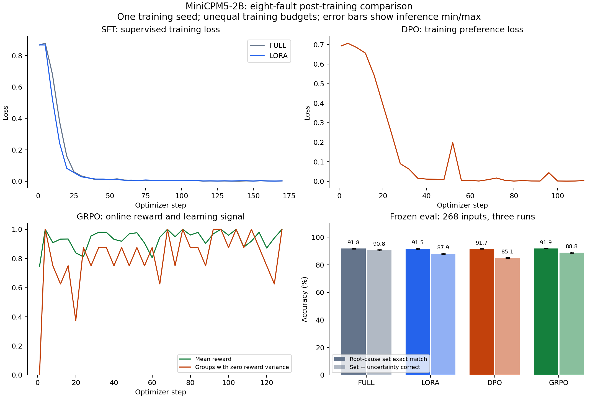

# 八类故障：全参 SFT、LoRA、DPO、GRPO 对照

训练与评估完成：2026-09-30。交付复核：2026-10-09。

**本配置下，Full-SFT 的联合准确率最高（90.80%）；GRPO 的集合匹配率略高，
但相对 LoRA 的配对区间跨零，尚不能认定有稳定提升。DPO 的主要退化在补充观测判断，
复合故障联合准确率降至 54.69%。** 建议保留 Full-SFT 作为八类任务的离线参考模型，
先补强可辨识性和补测请求，再评估新的偏好优化方案。八类模型尚未接入在线诊断链路。

## 数据与比较口径

数据版本 `hard_faults_v1`：训练 912、验证 200、冻结评估 268 条，
分别来自 456 / 100 / 134 个仿真炉次；同炉次两个窗口留在同一集合。
四个方法各三次推理，共 3,216 条预测。三次是推理 seed=1/2/3，训练 seed 均为 42。
数据隔离、物理机制、反事实标签和局限见[八类故障数据集报告](HARD_FAULT_DATASET.md)。

评估直接请求各自模型端点，关闭思考、仲裁和级联；temperature=0.1、top_p=0.95、
max_tokens=640、服务 seed=42。没有使用生产图谱或大模型兜底纠正结果。
本轮复核保持原始数据、训练权重、评分规则和评估输出不变。

- **集合匹配**：预测的可辨识根因集合与金标完全相同，不计主次。
- **联合准确率**：集合与 `needs_more_data` 同时正确；报告选型主要依据这一项。
- **Macro-F1**：八类故障分别计算 F1 后平均，再对三次推理取均值。
- **证据可追溯**：检查所引用数字是否对应被指名传感器的可见统计；这是规则检查，不能证明诊断因果链完整或证据语义完全正确。
- **Brier**：以联合判断正确为目标，只统计格式可解析输出；训练置信度为合成教学值，不能解释为真实设备上的概率校准。

## 总体结果

| 方法 | 根因集合完全匹配 | 集合＋不确定性正确 | Macro-F1 | 证据可追溯 | Brier ↓ |
|---|---:|---:|---:|---:|---:|
| full | 91.79% | 90.80% | 0.9400 | 99.38% | 0.1651 |
| lora | 91.54% | 87.94% | 0.9314 | 98.88% | 0.1756 |
| dpo | 91.67% | 85.07% | 0.9306 | 98.88% | 0.1825 |
| grpo | 91.92% | 88.81% | 0.9337 | 99.13% | 0.1735 |

各方法 JSON 合法率均为 100%，请求错误与输出截断均为 0。

| 方法 | 补测判断准确率 | 补测精确率 | 补测召回率 | SOP 召回率 | 未注入故障误报率 |
|---|---:|---:|---:|---:|---:|
| Full | 97.26% | 96.14% | 93.43% | 93.66% | 8.33% |
| LoRA | 95.40% | 91.51% | 91.08% | 91.42% | 8.33% |
| DPO | 93.03% | 90.67% | 82.16% | 90.49% | 8.33% |
| GRPO | 96.14% | 94.18% | 91.08% | 92.48% | 8.33% |

未注入故障子集只有 12 个窗口，各方法每轮均误报 1 个；不能据此声称满足旧四类任务的 <5% 误报目标。
该子集可能含缺失通道，不等同于 `meta.kind=normal`；71 个窗口的金标要求补充观测。

## 分层结果

每格为“集合匹配 / 联合准确率”，分母为每轮样本数；子集允许重叠。

| 子集 | 窗口数 | Full | LoRA | DPO | GRPO |
|---|---:|---:|---:|---:|---:|
| 复合故障 | 64 | 74.48% / 72.92% | 78.12% / 72.40% | 72.92% / 54.69% | 79.17% / 72.40% |
| 缺失通道 | 66 | 95.45% / 95.45% | 98.48% / 94.44% | 100.00% / 83.84% | 98.48% / 93.43% |
| 偏移工况 | 148 | 91.89% / 91.22% | 90.54% / 89.19% | 92.57% / 88.06% | 90.77% / 89.19% |
| 原范围工况 | 120 | 91.67% / 90.28% | 92.78% / 86.39% | 90.56% / 81.39% | 93.33% / 88.33% |
| 弱信号 | 96 | 96.88% / 96.88% | 94.79% / 94.79% | 96.88% / 96.88% | 95.49% / 95.49% |

复合故障仍是主要难点。缺失通道的集合匹配看似较高，是因为金标仅保留可见根因；
DPO 在该子集达到 100% 集合匹配，却经常没有请求补测，联合准确率仅 83.84%。

### 各类故障 F1

标签数为每轮金标出现次数，双根因窗口同时计入两类。

| 故障 | 标签数 | Full | LoRA | DPO | GRPO |
|---|---:|---:|---:|---:|---:|
| 过滤器堵塞 | 30 | 0.9312 | 0.8688 | 0.8074 | 0.8588 |
| 水泵气蚀 | 24 | 0.8505 | 0.7847 | 0.7907 | 0.8121 |
| 管道泄漏 | 33 | 0.9846 | 1.0000 | 1.0000 | 1.0000 |
| 线圈结垢 | 32 | 0.9633 | 0.9529 | 0.9638 | 0.9490 |
| 换热器散热衰退 | 33 | 0.9851 | 0.9851 | 0.9851 | 0.9851 |
| 水质恶化 | 38 | 1.0000 | 1.0000 | 1.0000 | 1.0000 |
| 电气柜散热风机失效 | 27 | 0.8054 | 0.8800 | 0.8980 | 0.8800 |
| 补水阀卡开 | 32 | 1.0000 | 0.9796 | 1.0000 | 0.9846 |

Full 的总体表现较好，但柜风机失效 F1 低于其余方法；不能将总体排序理解为逐类都更优。

## 配对区间与错误分析

以 **134 个炉次**为抽样单位，bootstrap 10,000 次（seed=42），
每次保留同炉次所有窗口及三次推理，各方法使用完全相同的抽样。
区间为 2.5%/97.5% 分位数，点估计继续按窗口计权。

| 方法 | 集合匹配率 [95% 区间] | 联合准确率 [95% 区间] |
|---|---:|---:|
| Full | 91.79% [88.06%, 95.15%] | 90.80% [86.94%, 94.28%] |
| LoRA | 91.54% [88.18%, 94.65%] | 87.94% [84.08%, 91.54%] |
| DPO | 91.67% [87.69%, 95.15%] | 85.07% [79.85%, 90.05%] |
| GRPO | 91.92% [88.81%, 94.90%] | 88.81% [85.45%, 92.16%] |

| 相对 LoRA | 集合匹配差值及区间（百分点） | 联合准确率差值及区间（百分点） |
|---|---:|---:|
| Full | +0.25 [−1.87, +2.36] | +2.86 [+0.25, +5.60] |
| DPO | +0.12 [−1.99, +2.11] | −2.86 [−5.85, +0.00] |
| GRPO | +0.37 [−0.75, +1.62] | +0.87 [−0.75, +2.61] |

三种方法相对 LoRA 的集合匹配差值区间都跨零。Full 的联合准确率区间在零以上，
可作为本次离线选型依据；这些是固定权重下的探索性比较，未经多重比较校正，
不包含训练种子变化，也不代表真实设备分布下的区间。

| 方法 | 仅集合错误 | 仅补测判断错误 | 两者都错 | 格式错误 | 补测漏报 FN | 补测误报 FP |
|---|---:|---:|---:|---:|---:|---:|
| Full | 52 | 8 | 14 | 0 | 14 | 8 |
| LoRA | 60 | 29 | 8 | 0 | 19 | 18 |
| DPO | 64 | 53 | 3 | 0 | 38 | 18 |
| GRPO | 59 | 25 | 6 | 0 | 19 | 12 |

每行基于 804 个预测，前四类错误互斥；FN/FP 为交叉统计，不能重复相加。
DPO 补测漏报由 LoRA 的 19 次增至 38 次，同时仅补测判断错误由 29 次增至 53 次。

**可追溯案例**：第 1 轮 `index=13`，炉次 `eval-00119`、窗口终点 1,200 s，
缺失流量、出水温度和压力。金标仅支持“管道泄漏”，并要求补测以确认其余原因。
LoRA 与 DPO 都报出泄漏，但 DPO 将 `needs_more_data` 改为 `false`，且省略补测 SOP。
该例两者的证据字段也未通过完整追溯检查，说明联合诊断指标与证据指标必须分别报告。
原文见各方法 `eval/run1.jsonl` 第 14 行；全部失败索引见本轮 `analysis.json` 的 `methods.*.errors.failures`。

## 训练配置、成本与曲线

| 项目 | Full-SFT | LoRA-SFT | DPO | GRPO |
|---|---|---|---|---|
| 初始化 | 原始 MiniCPM5-2B | 原始 MiniCPM5-2B | 本轮 LoRA 合并权重 | 同一 LoRA 合并权重 |
| 优化预算 | 3 epochs / 171 步 | 3 epochs / 171 步 | 1 epoch / 114 步 | 固定 128 步 |
| 学习率 | 1e-5 | 1e-4 | 5e-6 | 5e-6 |
| 有效 batch | 16 | 16 | 8 对偏好 | 8 条生成 / 每组 4 条 |
| LoRA 参数 | — | rank=32 / alpha=64 / dropout=0.05 | 同左，新 adapter | 同左，新 adapter |
| 训练数据 | 912 条 SFT | 同左 | 912 对合成偏好，200 对验证 | 912 条训练提示池 |
| 完整命令耗时（分钟） | 47.21 | 47.22 | 33.15 | 64.63 |
| 采样训练进程显存峰值（MiB） | 20,686 | 22,108 | 22,004 | 7,802 |

SFT 使用 BF16、gradient checkpointing 和 paged_adamw_8bit，验证集独立且不参与梯度更新。
DPO beta=0.1；GRPO beta=0.04、temperature=1.1、top_p=0.95。
GRPO 采用固定步数，日志最终 epoch≈0.281，不能写作完整遍历一轮提示池。
规则奖励为集合完全匹配 0.4、样本 F1 0.2、补测正确 0.2、证据 0.1、SOP 0.05、格式 0.05；置信度不参与奖励。

DPO、GRPO 的时间是 LoRA-SFT 后的额外成本；含前置 SFT 的训练命令总耗时分别约为
80.38 和 111.85 分钟，均未计模型合并和行为评估。显存为每秒采样的子进程峰值，
可能遗漏瞬时峰值；PyTorch allocated/reserved 另列于机器报告。
LoRA 在本配置下没有节省完整命令时间或采样峰值显存；GRPO 的峰值较低不能视作等预算比较。



[SVG 矢量图](assets/minicpm5_hard_comparison.svg)。图中误差线是三次推理的最小/最大值，
**不是**上表的炉次 bootstrap 区间。SFT、DPO、GRPO 的训练目标不同，不能跨算法比较 loss 数值。
DPO 验证偏好准确率为 97.50%，但冻结诊断没有同步改善；合成偏好拟合程度不等于业务效果。
GRPO 多个记录步的组内奖励方差为零，第 128 步该比例为 100%；
这是部分采样组缺少相对学习信号的证据，不能仅凭最后一次 reward=1 判断任务解决。

## 交付核验与复现

2026-10-09 已完成：

- 全量 1,380 条数据的数值、标签、证据、集合隔离与历史指纹核验，51 个炉次 / 102 个窗口回放一致。
- 3,216 条预测逐项对齐输入 SHA256、金标与元数据，原始输出重新评分一致。
- 逐轮总体、分层、逐类和截断计数重新汇总；检查比较均值、训练清单、资源记录、源码快照和偏好数据指纹一致。
- 17 项相关测试通过：4 项仿真回归、5 项多根因评分测试、8 项分析回归。分析测试覆盖汇总篡改、窗口错配、重复推理不得缩窄炉次区间及不等长炉次计权。
- 报告、PNG/SVG 配图和后训练测试已解除 Git 忽略；数据、权重与原始运行日志仍使用本机归档。

| 产物 | 路径 |
|---|---|
| 原始运行清单 / 对照汇总 | `logs/hard_minicpm5_20260929/{pipeline,comparison}.json` |
| 逐轮输出 / 摘要 / 评估清单 | `logs/hard_minicpm5_20260929/{full,lora,dpo,grpo}/eval/` |
| 本轮复核、区间、错误索引 | `logs/hard_analysis_20261009/{analysis.json,analysis.md}` |
| 本轮全量数据审计 | `logs/hard_analysis_20261009/dataset_audit.json` |
| 训练权重 | `saves/mff-{full,lora,dpo,grpo}-hard-minicpm5-2b-20260929/` |
| 合并权重 | `saves/mff-{lora,dpo,grpo}-hard-minicpm5-2b-20260929-merged/` |

`data/`、`saves/` 实际指向 `/models/hch/Agent_MFF_Early_Warning/` 下的对应目录。
新克隆仓库需要取得这些归档才能重算完整实验；分析单元测试自身不依赖模型或数据文件。
本轮重算命令（在项目根目录运行，输出目录可换成新的审计目录）：

```bash
/home/huachenghao/.conda/envs/mff_agent/bin/python tools/audit_hard_sft_data.py \
  --replay --report logs/hard_analysis_20261009/dataset_audit.json

/home/huachenghao/.conda/envs/mff_agent/bin/python tools/analyze_hard_comparison.py \
  --run-dir logs/hard_minicpm5_20260929 --out-dir logs/hard_analysis_20261009 \
  --bootstrap-resamples 10000 --bootstrap-seed 42

MPLCONFIGDIR=/tmp/mff-matplotlib /home/huachenghao/.conda/envs/mff_agent/bin/python \
  tools/plot_hard_comparison.py --run-dir logs/hard_minicpm5_20260929 \
  --analysis logs/hard_analysis_20261009/analysis.json

/home/huachenghao/.conda/envs/mff_agent/bin/python -m unittest discover \
  -s tests -p 'test_hard*.py' -v
/home/huachenghao/.conda/envs/mff_agent/bin/python -m unittest discover \
  -s tests -p test_extended_simulator.py -v
```

历史训练命令可从 `comparison.json` 的 `training_manifest.command` 及 `pipeline.json` 的阶段记录恢复。
`tools/run_hard_comparison.py --plan-only` 可只读展示编排；重新训练需同步修改 YAML 中的输出目录、
DPO/GRPO 起始合并权重及偏好路径，再选择新的 tag/run-dir，不能直接覆盖 20260929 归档。
仅更换控制器 `--tag` 不会自动重写 YAML 内固定路径。

## 下一阶段的验证边界

本轮是合成规则反馈，未开展人工 RLHF 或 AI 裁判 RLAIF；训练仅一个种子，预算不等。
同一仿真模型下的设备参数与环境偏移不等于真实独立设备验证；
反事实可观测性也不证明根因仅凭提示就可唯一识别。

后续先在训练/验证范围审查复合故障的可辨识性，增加“根因正确但遗漏补测”的偏好负例，
并检查气蚀、堵塞、柜风机故障的观测支持。冻结评估集只用于报告，不能回填为训练样本。
新方案应在新冻结集、多训练种子及可比预算下验证，再考虑接入八类在线诊断和真实反馈闭环。
