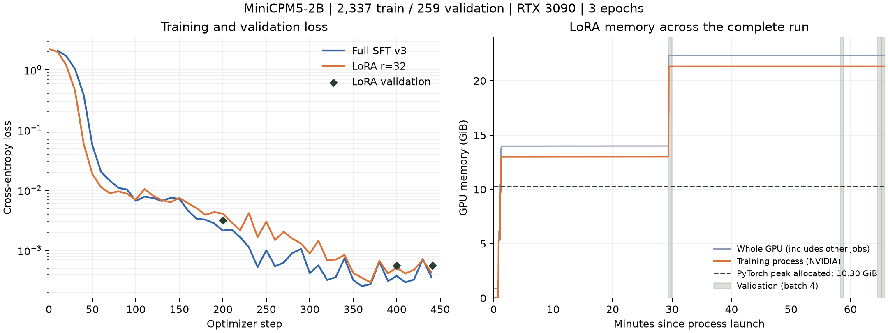

# MiniCPM5-2B：LoRA 与全参 SFT 对照实验

> LoRA 训练：2026-09-23；复测及修订：2026-09-24。
> 全参对照：2026-09-10 的 v3 权重 `~/models/mff-sft-minicpm5-2b`。
> 本次 LoRA 从原始 MiniCPM5-2B 底座训练，已完成 3 epochs / 441 步。
> 配套：[后训练完整记录](SFT_POSTTRAINING_RECORD.md)、[历史全参评估](SFT_EVAL_REPORT.md)。
> 2026-09-28 新增：[DPO / GRPO 后训练对照](SFT_RL_COMPARISON.md)，从本报告的 LoRA-SFT 权重出发。

## 1. 对照范围与证据

两套方案沿用现存 v3 数据划分、相同监督模板、单张 RTX 3090、3 epochs 和有效 batch 16。
学习率分别为全参 `1e-5`、LoRA `1e-4`；训练器及参数精度策略也有差异。
因此这是实际工程方案对照，不是只改变微调方式的单变量消融。

全参训练时长来自 `saves/mff-sft-full/train_results.json`，显存来自历史报告，
没有对应原始采样。LoRA 保存了配置、数据指纹、参数数量、训练曲线、PyTorch 显存峰值及 NVIDIA 进程采样。
历史全参未保存训练时的数据 SHA256，无法事后证明其训练文件与现存文件逐字节相同；
本次行为复测则对两种权重使用同一份带 SHA256 的评估文件。

已完成两种权重各 3 次、每次 200 条的行为复测。故障准确率均为 **99.41%**，
但 LoRA 的数据异常拒诊为 **8/10**，全参为 **9/10**；总体准确率分别为 **98.5% / 99.0%**。
本次 LoRA 的明确收益是可训练参数和训练产物体积减少，没有观察到训练或推理提速，
也没有足够同口径证据证明完整运行显存峰值下降。

## 2. 数据集

### 2.1 来源、格式与标签

`tools/gen_sft_data.py` 调用物理仿真器生成水泵气蚀、管道泄漏、线圈结垢、过滤器堵塞，
并构造工况切换、复合故障、误导工单和物理违规输入。故障标签来自仿真注入/生成器的主根因选择，
SOP 来自知识图谱，推理链由模板填入真实统计数值。
本次没有混入真实产线标注、通用指令集或大模型蒸馏样本。

每行 JSONL 的结构如下（这是格式说明，不是完整训练样本）：

```json
{
  "messages": [
    {"role": "system", "content": "诊断任务与输出要求"},
    {"role": "user", "content": "统计特征、实时特征、工况、维修工单、图谱候选和输出格式"},
    {"role": "assistant", "content": "引用真实数值的推理链 + root_cause/confidence/evidence/sop JSON"}
  ],
  "meta": {"kind": "clear", "gold": "水泵气蚀", "seed": 101, "stats": {}}
}
```

实际输入采用退化版 prompt：删除显式判定规则，保留诊断证据，以检验权重中的鉴别知识。
`meta` 仅用于审计与分层，不输入模型。只有 assistant 回答计入 loss；
system、user 和非思考模式的空思考前缀均以 `-100` 屏蔽。

### 2.2 规模与分布（实际文件统计）

| 类别 | train | val | eval | 用途 |
|---|---:|---:|---:|---|
| clear | 1082 | 118 | 80 | 四类故障清晰签名 |
| boundary | 546 | 54 | 60 | 气蚀/泄漏、堵塞/结垢边界鉴别 |
| transition | 258 | 38 | 20 | 工况切换正常波动 |
| composite | 185 | 15 | 20 | 复合故障主根因 |
| misleading | 181 | 19 | 10 | 工单与实时证据冲突 |
| antihall | 85 | 15 | 10 | 物理违规输入与拒诊 |
| **合计** | **2337** | **259** | **200** | |
| 文件大小（十进制 MB） | 8.151 | 0.906 | 0.699 | |

训练与验证来自 2596 条样本池随机切分，验证集约占 10%。
故障 seed 为 `101–106`，正常/异常数据 seed 为 `201–208`；
评估另用 `901、902、951、952`，与 train/val 不相交。
评估故障子集有 170 条：气蚀 44、泄漏 56、结垢 31、堵塞 39；另有无故障 20、数据异常 10。

| token 统计（原生模板，未 padding） | train | val | eval |
|---|---:|---:|---:|
| 完整序列平均长度 | 1017.02 | 1018.05 | 1018.97 |
| 完整序列最大长度 | 1080 | 1080 | 1080 |
| 完整序列 P95 | 1057 | 1052 | 1057 |
| assistant 监督 token 平均数 | 180.21 | 178.93 | 180.60 |
| assistant 监督 token 总数 | 421159 | 46343 | 36119 |
| cutoff=4096 的截断样本 | 0 | 0 | 0 |

### 2.3 审计与局限

原有 JSON/GOLD/SOP/FAITH/QUOTA/LEAK/GVIO 七项审计通过。
新增全量模板检查：**2796/2796 条**原生模板与 LLaMA-Factory `minicpm5` 的输入 token、
loss 掩码相同，没有截断、空监督或边界错位。

新增重复输入审计发现：

- train 2337 行只有 1719 个唯一输入；val 259 行有 248 个；eval 200 行有 182 个。
- train/val 共享 119 个唯一输入，涉及 **128/259 条验证样本（49.4%）**。
- train/eval 和 val/eval 的相同输入数均为 0；相同输入的金标签冲突为 0。

因此，验证集不是严格独立的泛化验证集，接近零的验证 loss 不能证明真实产线泛化。
独立 seed 的 eval 更适合本轮行为对比，但仍来自相同仿真器，且内部存在重复输入；
200 行不能视为 200 个完全独立场景。本轮保留原划分以维持方案可比性。
下一轮应按完整仿真场景/输入分组去重划分，并引入真实设备数据测试。

数据 SHA256：

```text
train  3736c08efa8b72a4762c32a44252b9d2948157fcfa0870f8c3defb1f54d79327
val    594dc52b9954dd717ab1452140476bd65f234a47651766bfd0bae11946cca90d
eval   feb6a77fc481c15a2a5b373fb575bb563aace45f632086ff9cb800650c7a3018
```

完整统计：`logs/lora_minicpm5_20260923/dataset_manifest.json`。

## 3. 硬件、环境和训练参数

训练使用单张 **RTX 3090 24 GiB（物理 GPU1）**。机器有 4 张卡，其他任务共享使用。
驱动 `580.126.09`，PyTorch CUDA `13.0`。
训练环境 `mff_sft`：Python 3.11.16、torch 2.14.0+cu130、transformers 5.8.0、
PEFT 0.18.1、accelerate 1.11.0、bitsandbytes 0.50.2、datasets 4.0.0。
全参使用 LLaMA-Factory 0.9.6.dev0；LoRA 使用 Transformers Trainer + PEFT。

| 参数 | 全参 SFT v3 | 本次 LoRA |
|---|---|---|
| 初始权重 | MiniCPM5-2B 原始底座 | 同一底座，未接续全参权重 |
| 底座参数量 | 2,516,756,480 | 2,516,756,480（冻结） |
| 可训练参数 | 2,516,756,480 | **50,233,344** |
| LoRA 配置 | — | r=32，alpha=64，dropout=0.05，bias=none |
| LoRA 目标 | — | 42 层 × q/k/v/o/gate/up/down，共 294 个线性层，排除 lm_head |
| 可训练参数占比 | 100% | 含 adapter 总参数的 1.9569%（相当于底座的约 2.00%） |
| train / val | 2337 / 259 | 2337 / 259 |
| 模板/思考开关 | minicpm5 / false | 原生 chat template / false；全量监督掩码一致 |
| batch / 累积 / 有效 batch | 2 / 8 / 16 | 2 / 8 / 16 |
| eval batch | 4（历史训练内未触发） | 4 |
| epochs / optimizer steps | 3 / 441 | 3 / 441 |
| learning rate | 1e-5 | 1e-4 |
| scheduler / warmup ratio | cosine / 0.1 | cosine / 0.1 |
| optimizer | paged_adamw_8bit | paged_adamw_8bit |
| weight decay / max grad norm | 0 / 1.0 | 0 / 1.0 |
| 精度 | pure_bf16；可训练底座 BF16 | 冻结底座 BF16；adapter FP32；BF16 autocast |
| gradient checkpointing | true | true |
| cutoff / packing | 4096 / 无 | 4096 / 无 |
| seed / dataloader workers | 42 / 4 | 42 / 4 |
| logging / save steps / 保留 checkpoint | 10 / 200 / 3 | 10 / 200 / 3 |
| 训练内验证 | 未触发，事后补算 | step 200、400、441；训练后另复核一次 |

这是 BF16 底座的常规 LoRA，没有对底座做 4-bit 量化，不是 QLoRA。
配置：`tools/mff_full_sft.yaml`、`tools/mff_lora_minicpm5.yaml`；
本次实际配置：`saves/mff-lora-minicpm5-2b-20260923/resolved_config.json`。

## 4. 训练时长、显存和产物

| 项目 | 全参 SFT v3 | 本次 LoRA |
|---|---:|---:|
| Trainer train_runtime | 3604.1156 s（60 分 04 秒） | **3849.9157 s（64 分 10 秒）** |
| 进程端到端墙钟时间 | 未留同口径测量 | 3947.1237 s（65 分 47 秒） |
| 吞吐 | 1.945 samples/s | 1.821 samples/s |
| 全程平均 train_loss | 0.1225035 | 0.0880876 |
| 最终 val loss | 约 0.0004（历史逐 token NLL） | 0.0005608（Trainer 汇总） |
| 最终权重文件 | 5,033,557,128 B（约 4.69 GiB） | adapter 201,012,176 B（约 191.70 MiB） |
| 训练输出目录（含 3 个 checkpoint） | 40,302,744,088 B（约 40.30 GB） | 1,152,045,162 B（约 1.15 GB） |

LoRA 的 Trainer 计时比历史全参多 **6.8%**。LoRA 训练内实际执行了 3 次验证，
合计 104.03 s；全参历史训练没有执行验证。保存体积、训练后端和参数精度也不同，
不能把时间差全部归因于 LoRA 算法。本配置显著缩小训练产物，但没有带来训练提速。
两栏 val loss 的汇总口径不同，不能据其细微差距给模型能力排序。

LoRA 验证轨迹：step 200 为 `0.00316908`，step 400 为 `0.00055844`，
step 441 为 `0.00056077`。最后有轻微回升；保留预定 3 epochs 的最终 checkpoint 做对照，
没有依据 eval 集挑选 checkpoint 或调参。

### 显存口径

| 口径 | 本次 LoRA 峰值 | 来源 |
|---|---:|---|
| PyTorch allocated（活跃张量分配） | 10551.70 MiB = **10.30 GiB** | `torch.cuda.max_memory_allocated()` |
| PyTorch reserved（分配器保留，含缓存） | 21502 MiB = **21.00 GiB** | `torch.cuda.max_memory_reserved()` |
| NVIDIA 训练进程占用 | 21826 MiB = **21.31 GiB** | 按训练 PID 每约 1 秒采样 |
| NVIDIA 整卡占用（含其他任务） | 22846 MiB = **22.31 GiB** | GPU1 整卡采样 |
| 开始前整卡占用 | 887 MiB | 含已有的其他进程 |

全参历史报告写作“峰值 **21.2 GB**”，未保存采样和 GB/GiB 定义，不能与上述数值
做精确的显存节省百分比计算。LoRA 训练早期进程占用约 13.0 GiB，
验证后缓存保留升高，因此 **13.0 GiB 不是完整运行峰值**。
评估和动态长度引起的分配器缓存/碎片可能影响 reserved，现有数据不足以单独量化各因素。
资源预算应使用完整进程/整卡峰值，不能只看 allocated。

采样覆盖加载、训练、训练内验证、保存和最终验证，共 3489 次有效采样、0 次采样失败。
进程从 `2026-09-23T02:28:26Z` 运行至 `03:34:13Z`，退出码 0。
证据：`logs/lora_minicpm5_20260923/train/{resource_summary.json,gpu_samples.jsonl,command.log}`。



左图显示日志中的训练 loss 和 LoRA 验证点；右图为完整进程/整卡显存，阴影表示验证阶段。
首次验证约在第 29.4 分钟，进程显存由约 13.0 GiB 升至 21.31 GiB。
横向虚线是全程 PyTorch allocated 峰值，不是逐秒张量占用曲线。
[SVG 矢量图](assets/minicpm5_lora_training.svg)；绘图命令：

```bash
MPLCONFIGDIR=/tmp/mff-lora-mpl conda run -n mff_sft python tools/plot_lora_comparison.py
```

## 5. 行为评估

使用 `tests/eval_sft_model.py` 和同一份 `data/sft/eval.jsonl`，关闭仲裁、无级联兜底。
每种权重在 GPU0 上用同配置 vLLM 服务运行 3 次，比较单模型首次输出。
两者均完成 3 次复测，各自每次的逐条根因预测完全一致；所有运行均无端点错误。

### 5.1 效果对照（2026-09-24 实测）

| 指标 | 全参 SFT v3 | LoRA | 说明 |
|---|---:|---:|---|
| 故障根因准确率（n=170） | **169/170 = 99.41%** | **169/170 = 99.41%** | 持平，均超过 90% |
| 总体准确率（n=200） | **198/200 = 99.0%** | **197/200 = 98.5%** | LoRA 少对 1 条 |
| 混淆对准确率（n=60） | 60/60 = 100% | 60/60 = 100% | 持平 |
| JSON 可解析率（n=200） | 100% | 100% | 均通过 |
| 证据忠实率（n=190） | 100% | 100% | 均通过 |
| 防幻觉校验通过率（n=190） | 100% | 100% | 此分母不包含 antihall |
| 正常工况误报率（n=20） | 0/20 = 0% | 0/20 = 0% | 持平 |
| 数据异常拒诊率（n=10） | **9/10 = 90%** | **8/10 = 80%** | LoRA 少拒诊 1 条，差 10 个百分点 |
| 含仲裁故障准确率（辅助项） | 82.94% | 82.94% | 低于原始输出，不用于主指标 |
| 置信度 gap（判对均值−判错均值） | −0.04343 | −0.05008 | 两者均未满足 >0.15 |
| 判错平均置信度 / 判错数 | 0.8750 / 2 | 0.8833 / 3 | 判错仍高置信，不宜作为安全门控 |
| P50（三次 P50 的平均） | 1.421 s | 1.423 s | 基本持平 |
| P95（三次 P95 的平均） | 1.779 s | 1.782 s | 均在 5 s 内 |

三项硬门槛全过，不能解释为数据质量拒诊已经全过：现有硬门槛的防幻觉统计明确排除了 antihall。
拒诊必须单列，不能被 99.41% 的故障准确率掩盖。

| 分层准确率 | 样本数 | 全参 | LoRA |
|---|---:|---:|---:|
| clear | 80 | 100% | 100% |
| boundary | 60 | 100% | 100% |
| transition | 20 | 100% | 100% |
| composite | 20 | 95% | 95% |
| misleading | 10 | 100% | 100% |
| antihall | 10 | 90% | 80% |

### 5.2 逐条差异与去重核验

每轮两模型在 **199/200 条**输入上的根因预测相同，唯一差异是 `idx=123`（文件第 124 行）。

| idx（从 0 计） | 样本与金标签 | 全参预测 | LoRA 预测 |
|---|---|---|---|
| 90 | 流量 80 L/s 超出项目输入校验上限 50 L/s；数据质量异常 | 无故障，错误 | 无故障，错误 |
| **123** | **流量 80 L/s 超出项目输入校验上限 50 L/s；数据质量异常** | **数据质量异常，正确** | **无故障，错误** |
| 124 | 复合故障，金标签主根因为水泵气蚀 | 管道泄漏，按主根因口径判错 | 管道泄漏，按主根因口径判错 |

复合样本中泄漏是伴随故障，但本评估按主根因严格计分。对 idx=123 的拒诊差异是本轮实际观察，
不能由 1 条差异推断所有 LoRA 或全参方法的一般优劣。

按完整 system+user 输入去重、每组保留首次出现记录后，三轮结果仍相同：

| 去重后的辅助指标 | 全参 | LoRA |
|---|---:|---:|
| 故障子集（n=152） | 151/152 = 99.34% | 151/152 = 99.34% |
| 全部唯一输入（n=182） | 180/182 = 98.90% | 179/182 = 98.35% |

去重不改变“故障持平、LoRA 多漏拒诊一条”的结论；这些仍是同源仿真数据，不代表真实产线验证。

### 5.3 评估耗时与服务资源

| 运行 | 全参耗时 | LoRA 耗时 | 全参 P95 | LoRA P95 |
|---|---:|---:|---:|---:|
| 1 | 288.0 s | 287.7 s | 1.774 s | 1.778 s |
| 2 | 287.5 s | 288.3 s | 1.780 s | 1.782 s |
| 3 | 287.9 s | 288.2 s | 1.783 s | 1.785 s |
| 平均 | 287.80 s | 288.07 s | 1.779 s | 1.782 s |

本次服务就绪时间：全参 308.84 s，LoRA 96.14 s。后启动的服务可受既有编译缓存影响，
不能把该差值当作 LoRA 固有的冷启动优势。两者就绪时 GPU0 整卡占用均为 **14419 MiB（14.08 GiB）**，
其中包含其他进程和 vLLM 的 KV cache 预留；这是就绪快照，不是推理全程峰值。
两套临时评估服务均已自动停止。

### 5.4 评估参数及统计解释

推理环境 `mff_sft_serve`：vLLM 0.28.0、transformers 5.16.1、torch 2.13.0+cu130。
两种模型均以合并后的 BF16 权重服务，`max_model_len=8192`、`max_num_seqs=8`、
`gpu_memory_utilization=0.5`、服务 seed=42，启用默认编译模式。
请求使用 `enable_thinking=false`、temperature=0.1、top_p=0.95、max_tokens=4000，
先做 3 条预热，再串行评估。评估端运行于 CPU。

`--seed 1/2/3` 在既有评估脚本中只是复跑编号，不会设置每次请求的采样 seed。
因此三次运行用于观察复跑稳定性，不能宣称为三个独立随机种子实验。
JSON 指标分母为 200；证据忠实/防幻觉使用 JSON 可解析且非 antihall 的样本，
全解析成功时分母为 190；无故障误报分母 20，数据异常拒诊分母 10。
单次 P95 为该次样本时延的分位数，冷启动和预热不计入样本时延。

## 6. 复现命令

以下均从 `/home/huachenghao/codes/Agent_MFF_Early_Warning` 运行。
已有训练/评估目录会被新脚本拒绝覆盖；复跑时为 `--output-dir` / `--out-dir` 选择新目录。

### 6.1 使用冻结数据并检查

```bash
conda run -n mff_agent python tools/audit_sft_data.py --dir data/sft
conda run -n mff_sft python tools/check_lf_template.py --n 5
conda run -n mff_sft python tools/inspect_sft_data.py \
  --check-lf-template \
  --out logs/lora_minicpm5_20260923/dataset_manifest.json
```

生成器说明命令（新目录，用于检查生成规则；本轮训练未重新生成数据）：

```bash
conda run -n mff_agent python tools/gen_sft_data.py --out-dir data/sft-rebuild
```

### 6.2 本次 LoRA 实际训练命令

```bash
/home/huachenghao/.conda/envs/mff_agent/bin/python tools/measure_run.py \
  --gpu 1 --out-dir logs/lora_minicpm5_20260923/train -- \
  /home/huachenghao/.conda/envs/mff_sft/bin/python tools/train_lora.py \
  --config tools/mff_lora_minicpm5.yaml \
  --output-dir saves/mff-lora-minicpm5-2b-20260923
```

`measure_run.py` 为子进程设置 `CUDA_VISIBLE_DEVICES=1`，保存完整命令和 stdout/stderr，
并按训练 Python 的 PID 采样显存。必须传训练环境的 Python 可执行文件，
不能把 `conda run` 当作被监控的训练 PID，否则进程显存对应关系会改变。

全参历史训练/导出命令如下，仅作对应说明；若重新训练，先复制 YAML、修改其输出目录，
避免原 YAML 中 `overwrite_output_dir: true` 覆盖历史产物：

```bash
CUDA_VISIBLE_DEVICES=1 conda run -n mff_sft llamafactory-cli train tools/mff_full_sft.yaml
conda run -n mff_sft llamafactory-cli export tools/mff_export.yaml
```

全参的 `pure_bf16: true` 是历史单卡训练能运行的关键配置，不能直接删去。

### 6.3 CPU 合并为 BF16 推理权重

```bash
OMP_NUM_THREADS=8 /home/huachenghao/.conda/envs/mff_sft/bin/python tools/merge_lora.py \
  --base-model /home/huachenghao/models/MiniCPM5-2B \
  --adapter saves/mff-lora-minicpm5-2b-20260923 \
  --output saves/mff-lora-minicpm5-2b-20260923-merged --dtype bfloat16
```

本次合并用 CPU，脚本主体耗时 **126.62 s**；使用 `safe_merge=True` 检查合并数值。
导出恢复为 2,516,756,480 参数，全部 BF16，保留 tokenizer、原生 chat template 和生成配置。
adapter 很小不代表独立部署模型变小：合并后的完整权重仍约 4.69 GiB，需要相同规模的底座推理计算。

最终 adapter 与 `checkpoint-441/adapter_model.safetensors` 的 SHA256 一致。
`tools/verify_export.py --merged saves/mff-lora-minicpm5-2b-20260923-merged` 的配置、tokenizer
和模板检查通过。合并进程退出时出现 DeepSpeed 的全局 Triton 缓存只读告警，发生在权重和清单保存之后；
进程退出码为 0，导出检查通过。该缓存告警不作为模型质量证据。

### 6.4 同配置三次行为复测

```bash
conda run --no-capture-output -n mff_agent python tools/run_adapter_eval.py \
  --model /home/huachenghao/models/mff-sft-minicpm5-2b \
  --name mff-full-comparison --gpu 0 --port 3763 --runs 3 \
  --out-dir logs/lora_minicpm5_20260923/full_eval

conda run --no-capture-output -n mff_agent python tools/run_adapter_eval.py \
  --model saves/mff-lora-minicpm5-2b-20260923-merged \
  --name mff-lora-comparison --gpu 0 --port 3763 --runs 3 \
  --out-dir logs/lora_minicpm5_20260923/lora_eval
```

依次运行，脚本为每个模型临时启动 `127.0.0.1:3763` 的独立服务，
就绪、预热、评估后停止自己启动的服务。训练模型路径和实际 vLLM 命令均写入清单。
复测使用原始模型输出；不会经 27B 级联补答来提高单模型指标。

完成后做配对汇总（校验相同数据指纹、推理配置、样本顺序，另算去重输入指标）：

```bash
conda run -n mff_agent python tools/summarize_lora_comparison.py
```

## 7. 产物与追溯

| 内容 | 路径 |
|---|---|
| LoRA adapter 和三个 checkpoint | `saves/mff-lora-minicpm5-2b-20260923/` |
| BF16 合并权重 | `saves/mff-lora-minicpm5-2b-20260923-merged/` |
| 配置、环境、参数数量及训练文件哈希 | adapter 目录的 `resolved_config.json`、`run_manifest.json` |
| train/eval loss、时间及 PyTorch 显存 | adapter 目录的 `lora_train_metrics.json`、`eval_metrics.json`、`trainer_state.json` |
| 时间戳训练曲线 | adapter 目录的 `progress.jsonl` |
| 整卡/进程显存、总墙钟、完整训练输出 | `logs/lora_minicpm5_20260923/train/` |
| 全量数据统计与模板核验 | `logs/lora_minicpm5_20260923/dataset_manifest.json` |
| 全参 / LoRA 逐条评估与三次汇总 | `logs/lora_minicpm5_20260923/{full_eval,lora_eval}/` |
| 配对差异与去重统计 | `logs/lora_minicpm5_20260923/comparison_summary.json` |

训练 adapter SHA256：`e91e618578b9dec7676f305d634284377145c23997271876308250b92014ea60`。
现有 `.gitignore` 包含 `design/`、`logs/`、`saves/` 和 `data/`。
已被版本库跟踪的报告仍会显示修改；新增对照报告、图表和实验产物默认被忽略。
本次没有改变忽略规则，新增文件已保存在本地工作区。

## 8. 结论与建议

1. **LoRA 在这份评估集上学到了与全参相近的故障鉴别能力**：故障 169/170、混淆对 60/60，
   三次复测稳定；数据异常拒诊少对 1 条，总体 197/200，未超过全参的 198/200。
2. **参数和存储节省明确**：只训练约 5023 万参数，adapter 191.70 MiB，
   含 checkpoint 的训练输出由约 40.30 GB 降到 1.15 GB（约减少 97.1%）。
   合并后的独立推理权重仍约 4.69 GiB，时延基本持平。
3. **本配置未体现训练提速或可严格量化的全程显存节省**：训练 64 分 10 秒，
   NVIDIA 进程峰值 21.31 GiB。后续若优化显存，需另测验证 batch、长度分组及分配器策略，
   不把本次 allocated 较小直接等同于进程占用较小。
4. **当前优先保留全参方案，LoRA 作为训练产物较小的备选**。推进替换前，应在按场景分组、
   去重后的新划分上补强量程越界拒诊，并加入真实设备评估。现有差异样本不用于本轮调参或重选 checkpoint。
5. **置信度与量化结论保持独立**：两者错误输出仍高置信，沿用已有“不依赖模型自报置信度做安全门控”的决定。
   本轮没有对 LoRA 做 INT4 实验，不能推断其量化效果优于全参。
