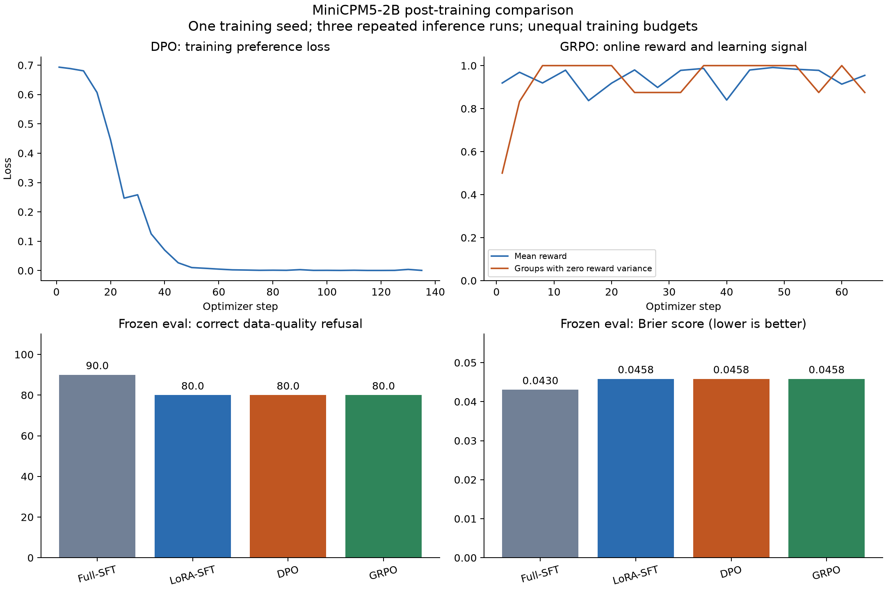

# MiniCPM5-2B：SFT、DPO 与 GRPO 对照

实验日期：2026-09-28。训练与评测记录：`logs/rl_minicpm5_20260928/`。
本记录补充 [LoRA / 全参 SFT 对照](SFT_LORA_COMPARISON.md)。

后续已完成[八类故障仿真与独立难例数据集](HARD_FAULT_DATASET.md)，
该扩展尚未重训模型；本报告分数仍对应下述冻结四类数据。

## 对照定义

| 方法 | 起点 | 学习信号 | 本轮范围 |
|---|---|---|---|
| Full-SFT | 原始 MiniCPM5-2B | 仿真标准答案，监督学习 | 使用既有三次同口径复测 |
| LoRA-SFT | 原始 MiniCPM5-2B | 同上 | 使用既有三次同口径复测；也是 RL 起点 |
| DPO-synthetic | 已合并的 LoRA-SFT | 仿真答案与规则验证负例的成对偏好 | 1 epoch，1,080 对训练偏好 |
| GRPO-rule | 同一个已合并的 LoRA-SFT | 在线采样，由金标和规则计算奖励 | 固定 64 次优化更新的探索性实验 |
| RLHF | 需要人工偏好或人工评分 | 人类反馈；优化器可采用 DPO/PPO/RLOO 等 | 本轮没有人工标注，不宣称完成 RLHF |
| RLAIF | 需要实际 AI 裁判或 AI 反馈 | AI 对答案打分或排序 | 本轮未运行 AI 裁判，不把规则奖励称为 RLAIF |

DPO 是离线偏好优化，GRPO 是在线策略优化；RLHF/RLAIF 描述反馈来源，
并不是四个互斥的优化器。用户授权构造数据后，本轮增加两个实际训练对照，
不再受真实产线偏好尚未累计 500 对的条件限制；生产反馈的积累仍是独立事项。

两种新方法均在 `saves/mff-lora-minicpm5-2b-20260923-merged` 上新建 adapter。
关闭新 adapter 即得到固定的 SFT 参考策略，DPO 的参考似然与 GRPO 的 KL 都以它为准。
没有用原始底座替代参考策略，也没有把 DPO 接在 GRPO 后面或反过来。

## 数据与隔离

原始 RL 池 `data/rl/prompts_gold.jsonl` 有 1,200 个唯一输入，来自已有物理仿真生成器。
故障种子 301–306，正常/异常种子 401–408；原 SFT 使用 101–106、201–208，
冻结测试使用 901–902、951–952；独立压力集使用 307–308、409–411。

`tools/build_synthetic_preferences.py` 构造一条输入对应一对偏好，并按类别分层、
按完整 system+user 输入划分 **1,080 训练 / 120 留出**。
`prefs_*` 和 `prompts_*` 的输入集合完全相同；同一输入不会跨训练与留出。
训练/留出共享仿真种子，因此留出偏好准确率只作拟合检查，独立泛化看冻结测试与压力集。

四类负例总计：错误根因 300、错误且过度自信 300、捏造证据数值 218、缺失 JSON 必需字段 382。
正负例采用相同 JSON 缩进，避免格式直接泄露偏好标签；错误根因限制在当前数据的标签集合。
每对都重新计算奖励，要求 chosen 正确、证据可追溯且 reward margin ≥0.05。
数据来源记为 `synthetic_rules`，人工标签数和 AI 裁判标签数均为 0。

正式数据及指纹在 `logs/rl_minicpm5_20260928/data_v2/manifest.json`。
此前 `data/` 是格式检查时的草稿，仅用于单步检查，不参与正式训练。
构建器拒绝输入重复、测试输入交叉、仿真种子交叉和覆盖已有输出。

冻结主测试为 `data/sft/eval.jsonl`：200 条、182 个唯一输入，SHA256：
`feb6a77fc481c15a2a5b373fb575bb563aace45f632086ff9cb800650c7a3018`。
另有 `data/rl/eval.jsonl` 的 300 条独立压力输入（100 拒诊 + 200 混合难例）。
新方法的结果只在训练完成后加入表格，未完成实验不填推测分数。

## 训练参数与奖励

| 参数 | DPO | GRPO |
|---|---|---|
| 可训练层 | all-linear LoRA，rank 32 / alpha 64 | 同左 |
| 精度 | 冻结底座 BF16、adapter FP32、BF16 autocast | 同左 |
| Dropout | TRL 禁用 | TRL 禁用 |
| 学习率 / 调度 | 5e-6 / cosine / warmup 0.1 | 同左 |
| batch / 梯度累积 | 1 / 8（8 对/步） | 1 / 8（8 个 completion/步） |
| 预算 | 1 epoch = 135 步 | 64 步，4 个 completion/prompt |
| beta | 0.1 | 0.04 |
| prompt / completion 上限 | 1280 / 640，总长度 1920 | 1280 / 640 |
| 采样 | 离线偏好，无在线采样 | temperature 1.3 / top_p 0.95 |
| seed / GPU | 42 / RTX 3090 GPU1 | 42 / RTX 3090 GPU0 |

这是实际工程配置对照，不是相同训练算力或相同样本曝光量的单变量消融。
GRPO 64 步共 512 个 completion（128 个 prompt 组）；不代表遍历整个 1,080 输入池，
也不代表算法已经收敛。两个方法都只有一个训练种子。

`R = 0.50*根因正确 + 0.15*(1-Brier) + 0.15*防幻觉 + 0.10*证据忠实 + 0.05*JSON + 0.05*SOP`。
不可解析 JSON、缺必需字段、非有限/越界置信度和错误字段类型直接得 0 分。
对物理越界输入只惩罚模型新增违规，避免把正确拒诊本身扣分。
评分使用原始 user 内容，不把 system 里的规则阈值当成可追溯证据。
空 SOP 字符串不会通过任意动作的子串匹配。

GRPO 使用 `loss_type=grpo`，不采用 TRL 默认的 DAPO 损失；截断 completion 不进入策略梯度。
训练监控保留奖励均值、奖励零方差比例、KL、熵、置信度分布和正确/错误置信度差。
奖励增加不等于独立测试质量提高；特别关注自报置信度整体提高而判错置信度不降的问题。

## 评测与结果

主测试沿用 `tools/run_adapter_eval.py`：BF16 vLLM、temperature 0.1、top_p 0.95、
max_tokens 4000、关闭思考与仲裁，直连临时模型服务，关闭级联兜底。
每个新方法已完成三次完整复测。重复推理不能解释成三个独立训练种子。

`tools/summarize_rl_comparison.py` 校验数据指纹、推理设置、逐行索引/标签和端点错误；
汇总故障/总体准确率、异常拒诊、正常误报、JSON、证据/防幻觉、Brier、10-bin ECE，
并保留去重输入上的准确率与 Brier。不同 GPU 或并发背景下的时延不作提速结论。

四种方法的主测试均完成三次完整复测，无端点错误。结果为三次均值：

| 方法 | 故障准确率（170） | 总体准确率（200） | 异常拒诊（10） | Brier ↓ | ECE ↓ |
|---|---:|---:|---:|---:|---:|
| Full-SFT | 99.41% | 99.00% | 90.00% | 0.0430 | 0.1580 |
| LoRA-SFT | 99.41% | 98.50% | 80.00% | 0.0458 | 0.1510 |
| DPO-synthetic | 99.41% | 98.50% | 80.00% | 0.0458 | 0.1510 |
| GRPO-rule | 99.41% | 98.50% | 80.00% | 0.0458 | 0.1510 |

四种方法的 JSON/证据忠实/防幻觉均 100%，正常工况误报均 0%。
**DPO、GRPO 在三轮中均与 LoRA-SFT 的根因、置信度、证据、SOP 逐条完全一致**，
不只是总体指标恰好相同。去重后的总体准确率亦同为 179/182 = 98.35%，
Full-SFT 为 180/182 = 98.90%。主集未观察到 RL 后训练带来的效果增益。

主集完整表和机器可读结果见 `logs/rl_minicpm5_20260928/comparison.{md,json}`；
逐条差异统计见 `prediction_differences.json`。



压力测试使用完全相同的 300 个唯一输入，四种方法各一次，均无端点错误：

| 方法 | 故障准确率（185） | 总体准确率（300） | 异常拒诊（100） | Brier ↓ | ECE ↓ |
|---|---:|---:|---:|---:|---:|
| Full-SFT | 100.00% | 92.67% | 78.00% | 0.1452 | 0.2993 |
| LoRA-SFT | 97.30% | 90.00% | 75.00% | 0.1611 | 0.2868 |
| DPO-synthetic | 97.30% | 90.00% | 75.00% | 0.1618 | 0.2864 |
| GRPO-rule | 97.30% | 90.00% | 75.00% | 0.1611 | 0.2868 |

四种方法的 JSON/证据忠实/防幻觉均 100%，正常误报均 0%。GRPO 与 LoRA-SFT 逐条输出一致；
DPO 根因与 LoRA-SFT 全部一致，仅 3 条置信度、2 条证据文本不同，Brier 略差。
压力集仅一次推理，不能将极小的校准指标变化解释为稳定效果。
完整结果见 `stress_comparison.{md,json}`。

**本轮结论：DPO 与 GRPO 均未改善当前 SFT 的诊断/拒诊表现，且增加训练成本。**
全参 SFT 在两套测试中的诊断和拒诊表现更好；本轮没有依据将部署模型升级为 RL 权重。
这不证明 DPO/GRPO 普遍无效：合成负例与真实模型错误分布不同，GRPO 奖励有差异的组仅 7/128，
训练预算与算法也未作等算力控制。后续提高难度应增加可观测故障机制和真实混淆样本，
并在新的隔离数据版本上比较，不能针对这些测试样本继续调参。

### 训练成本及学习信号

| 本次新增训练成本 | DPO | GRPO |
|---|---:|---:|
| 优化步数 | 135 | 64 |
| 训练循环耗时 | 1,353.38 s（22.56 min） | 1,763.04 s（29.38 min） |
| 完整训练命令耗时 | 1,459.58 s（24.33 min，含留出评估） | 1,799.12 s（29.99 min） |
| PyTorch allocated 峰值 | 9,840.39 MiB | 6,368.09 MiB |
| PyTorch reserved 峰值 | 22,048 MiB | 7,420 MiB |
| 每秒采样的训练进程显存峰值 | 21,274 MiB | 7,748 MiB |

NVIDIA 每秒采样可能遗漏短时峰值，不能将它与 allocator 的峰值视为同一指标。
上述时间是 SFT 之后增加的训练成本，不含原 LoRA-SFT 训练、合并及行为评测。
DPO 留出偏好准确率 100%，eval loss 0.000916；这是构造偏好上的结果，不能替代诊断评测。

两种 adapter 的 LoRA-B 均非零，确实发生权重更新。
GRPO 的 128 个 prompt 组中 **121 组（94.53%）奖励零方差，仅 7 组有组内差异**；
全部 512 个 completion 的 JSON/防幻觉通过率 100%，没有长度截断。
前/后 256 条采样的正确/错误置信度差分别为 −0.0432 / −0.1174。
两窗口的 prompt 不同，不能把这个差值变化解释为训练导致的校准改善或恶化；
它表明单靠平均训练奖励不足以支持校准结论。详见 `learning_signal.json`、`reward_monitor.jsonl`。

## 复现

使用已有隔离环境 `mff_rl`（TRL 0.24.0、Transformers 5.8.0、PEFT 0.18.1、Torch 2.14.0+cu130）。
`mff_agent` 运行数据构造/测量/行为评估，`mff_sft_serve` 运行 vLLM。
环境已有 TRL import-utils 兼容修复，记录见 `logs/rl_minicpm5_20260924/env/`。

```bash
/home/huachenghao/.conda/envs/mff_agent/bin/python tools/build_synthetic_preferences.py \
  --out-dir logs/rl_minicpm5_20260928/data_v2

/home/huachenghao/.conda/envs/mff_agent/bin/python tools/measure_run.py \
  --gpu 1 --out-dir logs/rl_minicpm5_20260928/dpo/train -- \
  /home/huachenghao/.conda/envs/mff_rl/bin/python tools/train_rl.py \
  --algo dpo --config tools/mff_dpo_synthetic_minicpm5.yaml

/home/huachenghao/.conda/envs/mff_agent/bin/python tools/measure_run.py \
  --gpu 0 --out-dir logs/rl_minicpm5_20260928/grpo/train -- \
  /home/huachenghao/.conda/envs/mff_rl/bin/python tools/train_rl.py \
  --algo grpo --config tools/mff_grpo_minicpm5.yaml
```

已有目录不会覆盖；重新实验应更换配置中的数据/输出目录及上述测量目录。
`tools/finish_rl_run.py --method dpo --gpu 1 --port 3763`（由 `mff_agent` Python 运行）
会等待训练成功，随后 CPU 合并 adapter、主集三次评测及压力集一次评测；
GRPO 对应 `--method grpo --gpu 0 --port 3764`。每阶段独立保存日志，训练失败不会进入评测。
训练产物包含 resolved/trainer config、数据/代码 SHA256、可训练参数量、优化步数、
损失与奖励日志、PyTorch 显存峰值、每秒 NVIDIA 进程显存采样。
`source/` 保存了训练时源码快照，其 SHA256 与两种训练清单一致。

## 存储迁移

按用户要求，6 个模型产物目录已迁移到 `/models/hch/Agent_MFF_Early_Warning/rl_runs/20260928/`，
从工程磁盘转出 **10,930,798,835 字节（10.18 GiB）**。包括两组正式 adapter/merged 权重和两组冒烟 adapter。
原 `logs/rl_minicpm5_20260928/` 下对应路径保留软链接，脚本和报告引用仍有效。
迁移逐文件校验 SHA256 后才移除原副本，清单在 `relocation_manifest.json`。
迁移脚本为 `tools/relocate_rl_artifacts.py`，默认仅盘点，`--apply` 执行。

本轮修复：离线图谱/奖励模块不再强制导入 HTTP 客户端；TRL 与 Transformers 5 的
`warnings_issued` 兼容；DPO 显式总长度及完整 completion 检查；GRPO 使用模板实际
停止符 `<|im_end|>`，其生成终止和损失掩码保持一致。

验证：5 项 RL 数据/奖励/指标单元测试、主集 200 条及压力集 300 条奖励与现有评测器一致性检查、
8 项 FakeLLM 离线级联回归；两种训练器均已通过单步执行检查。
